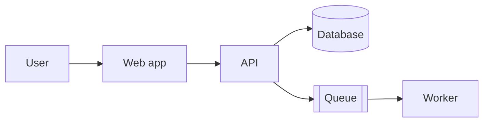
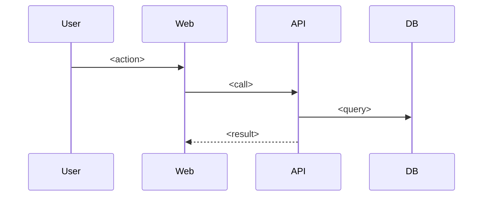

# Map: <repo, or repo/path>

_Generated <date>. Scope: <whole repo, or path>. Read only; commands not run._

## At a glance

<What it is, who uses it, and the problem it solves. Three lines.>

## Architecture



- **<Part>:** <what it does, one line>. `<path>`

## Main flow

<One key request or job, start to end.>



## Tech stack

| Area | Choice | Used for |
| ---- | ------ | -------- |
|      |        |          |

## Layout

```text
<folder>/   <what lives here>
```

## Key terms

- **<Term>:** <meaning in this project>.

## Principles and conventions

- **<Convention>:** <how code is written here>. Example: `<file:line>`

## Getting started

| Step | Command | Source |
| ---- | ------- | ------ |
| Install | `<cmd>` | from the docs / from the scripts |
| Run | `<cmd>` | |
| Test | `<cmd>` | |

Prerequisites: <runtime versions, services, env vars>.

## How to contribute

- **Branches:** <naming, base branch>
- **Commits:** <style>
- **Pull requests:** <template, review rules>
- **CI checks:** <what runs, what must pass>
- **Owners:** <from CODEOWNERS, or "not found">

## Gotchas

- <Surprising thing that bites newcomers.>

## Where to go next

- `/how <area or flow>`: <why it's worth reading next>
- `/why <decision>`: <why it matters>
- `/what <concept>`: <a concept the repo leans on>

## Open questions

- <What couldn't be confirmed from the repo.>
