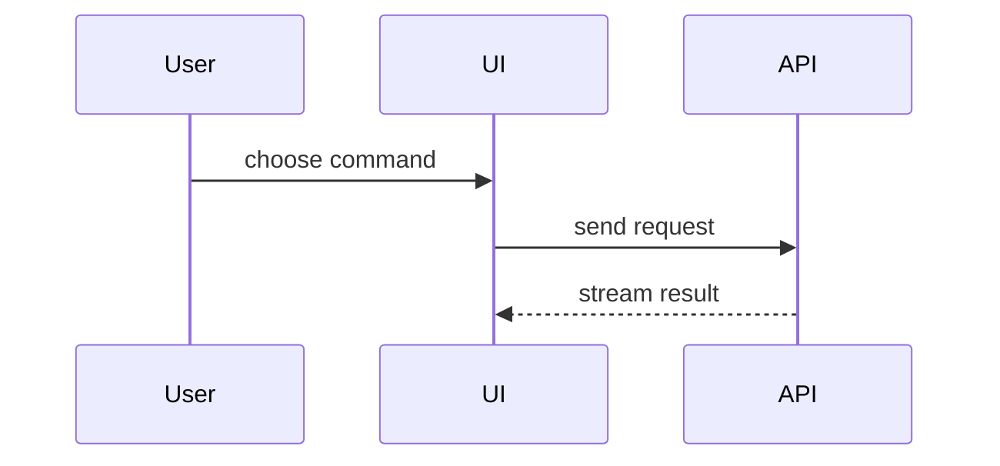

# Pictures for a PR

Pick the smallest view that makes the point. One or two, never all. Keep only the calls, files, and states the
reviewer needs.

| The change is about…               | Use                     |
| ---------------------------------- | ----------------------- |
| Logic or an algorithm              | Pseudocode              |
| Runtime control flow               | Call tree               |
| UI structure                       | Component tree          |
| Where things live, a wide refactor | Shallow file tree       |
| Components talking to each other   | Mermaid sequence        |
| A change to an existing shape      | `diff` of any of these  |
| A new block the reviewer must copy | The whole block of code |

## Pseudocode

```text
on(save)
  if content is unchanged
    return cached result
  write new content
  return fresh result
```

## Call tree

```text
submitForm
  createSession
    persistPrompt
    launchAgent
  navigateToSession
```

## Component tree

```text
<SessionPage> (apps/web/src/routes/session.tsx)
  useSessionEvents()
  <SessionToolbar>
    <RunSkillButton> (packages/ui)
```

## File tree

```text
src/
├── commands/       # parses user actions
├── sessions/       # owns session state
└── transport/      # sends API requests
```

## Mermaid sequence



## Diff sketch

Match the diff to the shape it changes:

```diff
 submitForm
   createSession
     persistPrompt
+    expandSkillMention
     launchAgent
```

```diff
 src/
 ├── sessions/
-└── transport.ts
+└── transport/
+    ├── client.ts
+    └── stream.ts
```
